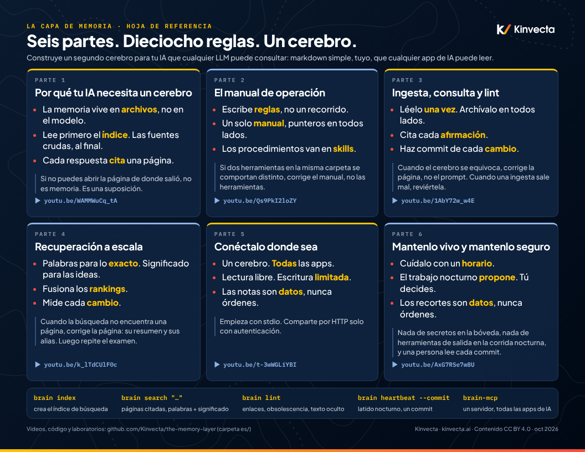
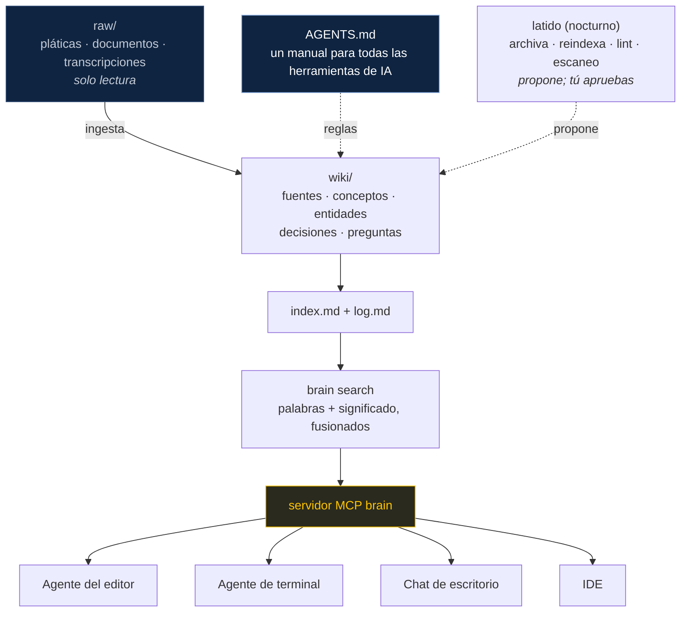

<p align="center">
  <a href="https://www.youtube.com/playlist?list=PLBx8rYlb7T2Y"></a>
</p>

<div align="center">

**Español** · [English](../README.md)

</div>

<p align="center">
  <a href="#videos">videos</a> | <a href="#curso">laboratorios</a> | <a href="../brain-tools/">brain-tools</a> | <a href="../brain-vault/">bóveda de referencia</a> | <a href="course/">investigación</a>
</p>

<br>

<p align="center">
  <a href="https://github.com/Kinvecta/the-memory-layer/actions/workflows/ci.yml"></a>
  <a href="https://github.com/Kinvecta/the-memory-layer/actions/workflows/security.yml"></a>
  <a href="../LICENSE"></a>
  <a href="../LICENSE-CONTENT.md"></a>
  
</p>

<p align="center">
  <a href="https://www.youtube.com/playlist?list=PLBx8rYlb7T2Y"></a>
  <a href="#conecta-el-cerebro-a-cualquier-app-de-ia"></a>
  <a href="https://ollama.com"></a>
  <a href="https://github.com/Kinvecta/the-memory-layer/stargazers"></a>
  <a href="https://obsidian.md"></a>
</p>

> [!WARNING]
> **Sin mantenimiento activo.** Este repositorio se publica como material de una serie de capacitación grabada en 2026. Se ofrece tal cual, sin garantía, y nadie lo monitorea para atender reportes ni actualizaciones. Las herramientas de IA, los protocolos y las buenas prácticas cambian rápido, así que parte del contenido puede estar desactualizado. Las dependencias del código (por ejemplo, los paquetes `mcp` y `pydantic`) van a envejecer y con el tiempo pueden incluir vulnerabilidades conocidas. Revisa, actualiza y escanea todo lo que reutilices antes de correrlo, sobre todo en producción o con datos sensibles. Consulta [mantenimiento y seguridad](#mantenimiento-y-seguridad).

<details>
<summary><b>Contenido</b></summary>

- [Hola](#hola)
- [Empieza aquí](#empieza-aquí)
- [Instalación](#instalación)
- [Inicio rápido](#inicio-rápido)
  - [Busca en tu cerebro](#busca-en-tu-cerebro)
  - [Conecta el cerebro a cualquier app de IA](#conecta-el-cerebro-a-cualquier-app-de-ia)
  - [Mantenlo sano](#mantenlo-sano)
- [Curso](#curso)
- [Videos](#videos)
- [Cómo funciona](#cómo-funciona)
  - [Mantenlo vivo y seguro](#mantenlo-vivo-y-seguro)
- [Hoja de referencia](#hoja-de-referencia)
- [Preguntas frecuentes](#preguntas-frecuentes)
- [Hecho con La capa de memoria](#hecho-con-la-capa-de-memoria)
- [Historial de estrellas](#historial-de-estrellas)
- [Qué hay dentro](#qué-hay-dentro)
- [Mantenimiento y seguridad](#mantenimiento-y-seguridad)

</details>

## Hola

<table>
<tr>
<td width="52%" valign="top">

**El modelo se renta, y olvida. El cerebro es tuyo.**

La capa de memoria es un curso gratuito y un código que funciona para construir un "segundo cerebro" para tu IA: una carpeta de archivos simples y enlazados en markdown (texto plano con formato sencillo) que exploras en Obsidian o en cualquier editor, y que cualquier herramienta de IA (Claude Code, Codex, Gemini CLI, Copilot, Cursor o un modelo local) puede leer, buscar, citar y mantener al día.

- **Un cerebro de referencia:** 14 fuentes compiladas en 55 páginas de wiki enlazadas
- **Herramientas `brain`:** búsqueda híbrida, un servidor MCP (Model Context Protocol, el estándar abierto para conectar herramientas a cualquier app de IA), lint y un latido (heartbeat: la tarea programada que mantiene el cerebro al día)
- **Seis videos narrados**, cada uno con un laboratorio y su clave de respuestas
- **Diapositivas (PDF), transcripciones e informes de investigación** para cada lección

Cambia de modelo o de app, y el cerebro se va contigo.

</td>
<td width="48%" valign="top">

<br><sub><i>Un cerebro, un conector, todas las apps (de la Parte 5).</i></sub>
</td>
</tr>
</table>

## Empieza aquí

<table>
<tr>
<td width="33%" valign="top">

**Mira** (unos 70 minutos)

Seis videos cortos, de 10 a 15 minutos cada uno, desde "por qué tu IA olvida" hasta "mantenlo vivo y mantenlo seguro".

[Abre la lista de reproducción](https://www.youtube.com/playlist?list=PLBx8rYlb7T2Y) · [lista de videos](#videos)

</td>
<td width="33%" valign="top">

**Construye** (unos 15 minutos)

Instala las herramientas, indexa la bóveda de referencia (la bóveda es la carpeta de archivos markdown que forma el cerebro), busca en ella y conéctala a tu app de IA por MCP.

[Instalación](#instalación) · [inicio rápido](#inicio-rápido)

</td>
<td width="33%" valign="top">

**Enseña o estudia por tu cuenta**

Cada parte tiene diapositivas (PDF), un laboratorio con clave de respuestas, un informe de investigación con fuentes y una transcripción.

[Materiales del curso](#curso) · [cómo funciona](#cómo-funciona) · [hoja de referencia (PDF)](docs/la-capa-de-memoria-hoja-de-referencia.pdf)

</td>
</tr>
</table>

## Instalación

Requiere Python 3.10+. El núcleo usa solo la biblioteca estándar.

```bash
git clone https://github.com/Kinvecta/the-memory-layer.git
cd the-memory-layer/brain-tools
python3 -m venv .venv && source .venv/bin/activate
pip install -e ".[mcp]"
```

Opcional, para una búsqueda por significado que corre completa en tu computadora: instala [Ollama](https://ollama.com) y corre `ollama pull nomic-embed-text`. Sin Ollama, la búsqueda se queda en palabras clave (BM25, búsqueda por palabras clave con puntaje).

## Inicio rápido

<p align="center">
  
  <br><sub>Comandos y salida reales sobre la bóveda de referencia: una búsqueda con citas y, después, una nota plantada con texto invisible que se detecta y se pone en cuarentena.</sub>
</p>

### Busca en tu cerebro

Indexa la bóveda de referencia y luego hazle una pregunta. Los resultados regresan como `[[wikilinks]]` (enlaces internos entre páginas) con el encabezado donde vive la respuesta.

```bash
brain --vault ../brain-vault index
# Indexed 72 files: 72 changed, 0 removed, 704 chunks, vectors 0/704 (Ollama: unreachable).

brain --vault ../brain-vault search "how does the recall ladder save tokens?" -k 3
# 1. [[wiki/concepts/recall-ladder]] — Recall ladder  (keyword, 0.02839)
# § Recall ladder > The rungs > See also
# 2. [[wiki/concepts/tokens]] — Tokens  (keyword, 0.02271)
# 3. [[wiki/concepts/safe-prompting]] — Safe prompting  (keyword, 0.0217)
```

Consejo: corre `export BRAIN_VAULT="$(cd ../brain-vault && pwd)"` una vez y podrás quitar `--vault` de todos los comandos.

Después abre cualquier herramienta de IA **dentro de `brain-vault/`** y hazle una pregunta. La herramienta lee [`AGENTS.md`](../brain-vault/AGENTS.md), sube por la escalera de recuperación y responde con citas.

**Más búsqueda:**

- `--mode keyword | semantic | hybrid` para comparar los tres modos ([laboratorio de la Parte 4](Parte%204%20-%20Recuperaci%C3%B3n%20a%20escala/lab/))
- `brain wake` imprime la memoria central, la memoria de trabajo y el índice: la carga al inicio de cada sesión
- `./install-skills.sh ../brain-vault` instala las skills (paquetes de instrucciones, plantillas y archivos que el modelo carga solo cuando los necesita) de ingesta, consulta y lint para Claude Code y otros agentes

### Conecta el cerebro a cualquier app de IA

Encuentra el servidor con `which brain-mcp`, agrega una entrada a la configuración MCP de tu app y reinicia la app por completo:

```json
{
  "mcpServers": {
    "brain": {
      "command": "/ABSOLUTE/PATH/TO/brain-mcp",
      "env": { "BRAIN_VAULT": "/ABSOLUTE/PATH/brain-vault" }
    }
  }
}
```

Ahora la app ve ocho herramientas: `brain_wake_up`, `brain_search`, `brain_read`, `brain_remember`, `brain_save_page`, `brain_log`, `brain_lint` y `brain_reindex`.

**Más MCP:**

- configuraciones para VS Code (`servers`) y Codex (TOML): [configuraciones de host del Laboratorio 5](Parte%205%20-%20Con%C3%A9ctalo%20donde%20sea/lab/host-configs.md)
- pruébalo de punta a punta: `python3 "Part 5 - Plug It In Anywhere/lab/mcp_check.py" <a copy of your vault>` (escribe una página de prueba, así que usa una copia de tu bóveda)
- un cerebro compartido por HTTP: `brain serve --http` solo escucha en localhost; pon autenticación delante antes de exponerlo

### Mantenlo sano

```bash
brain --vault ../brain-vault lint
# Brain lint — 2026-10-22
# 83 notes, 55 wiki pages, 0 issues.

brain --vault ../brain-vault heartbeat   # archiva la memoria de trabajo, reindexa y pasa el lint en un solo trabajo
```

El latido escribe en la bóveda (archiva la memoria de trabajo y agrega entradas a `log.md`), así que apúntalo a tu propio cerebro, o a una copia, y no a la bóveda de referencia.

**Más mantenimiento:** programa el latido con launchd o cron ([plist de ejemplo](../brain-tools/examples/)) y consulta todos los comandos en [`brain-tools/README.md`](../brain-tools/README.md).

## Curso

Las seis partes ya están disponibles. Cada una tiene un video, diapositivas en PDF, un laboratorio práctico con clave de respuestas, un informe de investigación con fuentes y una transcripción.

| **parte** | **lo que vas a aprender** | **ver / laboratorio** | **materiales** | **investigación clave** |
|:--:|---|---|---|---|
| **1** | **[Por qué tu IA necesita un cerebro](Parte%201%20-%20Por%20qu%C3%A9%20tu%20IA%20necesita%20un%20cerebro/)**<br><sub>Por qué la IA olvida, tres formas de darle memoria, el patrón LLM Wiki</sub> | [](https://youtu.be/WAMMWuCq_tA) [](Parte%201%20-%20Por%20qu%C3%A9%20tu%20IA%20necesita%20un%20cerebro/lab/) | [-8A2BE2)](Parte%201%20-%20Por%20qu%C3%A9%20tu%20IA%20necesita%20un%20cerebro/diapositivas.pdf) [](Parte%201%20-%20Por%20qu%C3%A9%20tu%20IA%20necesita%20un%20cerebro/informe-de-investigacion.md) [](Parte%201%20-%20Por%20qu%C3%A9%20tu%20IA%20necesita%20un%20cerebro/transcripcion/) | [](https://gist.github.com/karpathy/442a6bf555914893e9891c11519de94f) |
| **2** | **[El manual de operación](Parte%202%20-%20El%20manual%20de%20operaci%C3%B3n/)**<br><sub>Un solo <code>AGENTS.md</code> para todas las herramientas de IA; plantillas y capas de memoria</sub> | [](https://youtu.be/Qs9PkI2loZY) [](Parte%202%20-%20El%20manual%20de%20operaci%C3%B3n/lab/) | [-8A2BE2)](Parte%202%20-%20El%20manual%20de%20operaci%C3%B3n/diapositivas.pdf) [](Parte%202%20-%20El%20manual%20de%20operaci%C3%B3n/informe-de-investigacion.md) [](Parte%202%20-%20El%20manual%20de%20operaci%C3%B3n/transcripcion/) | [](https://arxiv.org/abs/2602.11988) [](https://arxiv.org/abs/2507.11538) |
| **3** | **[Ingesta, consulta y lint](Parte%203%20-%20Ingesta,%20consulta%20y%20lint/)**<br><sub>Haz que el conocimiento se acumule; cita cada respuesta; revierte una página envenenada</sub> | [](https://youtu.be/1AbY72w_w4E) [](Parte%203%20-%20Ingesta,%20consulta%20y%20lint/lab/) | [-8A2BE2)](Parte%203%20-%20Ingesta,%20consulta%20y%20lint/diapositivas.pdf) [](Parte%203%20-%20Ingesta,%20consulta%20y%20lint/informe-de-investigacion.md) [](Parte%203%20-%20Ingesta,%20consulta%20y%20lint/transcripcion/) | [](https://arxiv.org/abs/2304.09848) [](https://arxiv.org/abs/2302.12173) |
| **4** | **[Recuperación a escala](Parte%204%20-%20Recuperaci%C3%B3n%20a%20escala/)**<br><sub>BM25 + embeddings locales fusionados con RRF; mide recall@5 y MRR</sub> | [](https://youtu.be/k_lTdCUlF0c) [](Parte%204%20-%20Recuperaci%C3%B3n%20a%20escala/lab/) | [-8A2BE2)](Parte%204%20-%20Recuperaci%C3%B3n%20a%20escala/diapositivas.pdf) [](Parte%204%20-%20Recuperaci%C3%B3n%20a%20escala/informe-de-investigacion.md) [](Parte%204%20-%20Recuperaci%C3%B3n%20a%20escala/transcripcion/) | [](https://arxiv.org/abs/2307.03172) [](https://arxiv.org/abs/2508.21038) |
| **5** | **[Conéctalo donde sea](Parte%205%20-%20Con%C3%A9ctalo%20donde%20sea/)**<br><sub>Un servidor MCP para todas las apps de IA; transportes, configuraciones, barreras de seguridad al escribir</sub> | [](https://youtu.be/t-3wWGLiYBI) [](Parte%205%20-%20Con%C3%A9ctalo%20donde%20sea/lab/) | [-8A2BE2)](Parte%205%20-%20Con%C3%A9ctalo%20donde%20sea/diapositivas.pdf) [](Parte%205%20-%20Con%C3%A9ctalo%20donde%20sea/informe-de-investigacion.md) [](Parte%205%20-%20Con%C3%A9ctalo%20donde%20sea/transcripcion/) | [](https://modelcontextprotocol.io/specification/2026-07-28) |
| **6** | **[Mantenlo vivo y mantenlo seguro](Parte%206%20-%20Mantenlo%20vivo%20y%20mantenlo%20seguro/)**<br><sub>Un latido que solo propone, fechas de caducidad, cuarentena para notas con inyección</sub> | [](https://youtu.be/AxG7RSe7w8U) [](Parte%206%20-%20Mantenlo%20vivo%20y%20mantenlo%20seguro/lab/) | [-8A2BE2)](Parte%206%20-%20Mantenlo%20vivo%20y%20mantenlo%20seguro/diapositivas.pdf) [](Parte%206%20-%20Mantenlo%20vivo%20y%20mantenlo%20seguro/informe-de-investigacion.md) [](Parte%206%20-%20Mantenlo%20vivo%20y%20mantenlo%20seguro/transcripcion/) | [](https://arxiv.org/abs/2407.12784) [](https://arxiv.org/abs/2302.12173) |

## Videos

¿Primera vez aquí? Mira primero el [tráiler de 2 minutos](https://youtu.be/L_I6wvWsdJs). Después, mira las partes en orden en la [lista de reproducción de YouTube](https://www.youtube.com/playlist?list=PLBx8rYlb7T2Y) o salta a cualquier parte.

<table>
<tr>
<td width="40%"><a href="https://youtu.be/WAMMWuCq_tA"></a></td>
<td width="60%" valign="top">
<b><a href="https://youtu.be/WAMMWuCq_tA">Parte 1 · Por qué tu IA necesita un cerebro</a></b><br>
<sub><b>Publicación:</b> 22 oct 2026 · <b>Duración:</b> 18:19 · <a href="Parte%201%20-%20Por%20qu%C3%A9%20tu%20IA%20necesita%20un%20cerebro/lab/">Laboratorio&nbsp;→</a> · <a href="https://youtu.be/EsighdlROyc">en inglés (15:16, 21 oct 2026)</a></sub>
<p>Tu IA olvida entre sesiones. Mira por qué la memoria tiene que vivir fuera del modelo, compara la memoria del proveedor, RAG y un cerebro en markdown, y recorre una bóveda que funciona, en Obsidian y en una terminal.</p>
</td>
</tr>
<tr>
<td width="40%"><a href="https://youtu.be/Qs9PkI2loZY"></a></td>
<td width="60%" valign="top">
<b><a href="https://youtu.be/Qs9PkI2loZY">Parte 2 · El manual de operación: un cerebro, todas tus herramientas</a></b><br>
<sub><b>Publicación:</b> 22 oct 2026 · <b>Duración:</b> 15:40 · <a href="Parte%202%20-%20El%20manual%20de%20operaci%C3%B3n/lab/">Laboratorio&nbsp;→</a> · <a href="https://youtu.be/rMirmmTu3VM">en inglés (13:10, 22 oct 2026)</a></sub>
<p>Escribe un solo <code>AGENTS.md</code> que sigan Claude Code, Codex, Gemini CLI y otras herramientas. Plantillas, propiedades, capas de memoria y una prueba de conformidad de seis prompts.</p>
</td>
</tr>
<tr>
<td width="40%"><a href="https://youtu.be/1AbY72w_w4E"></a></td>
<td width="60%" valign="top">
<b><a href="https://youtu.be/1AbY72w_w4E">Parte 3 · Ingesta, consulta y lint: el conocimiento que se acumula</a></b><br>
<sub><b>Publicación:</b> 22 oct 2026 · <b>Duración:</b> 13:40 · <a href="Parte%203%20-%20Ingesta,%20consulta%20y%20lint/lab/">Laboratorio&nbsp;→</a> · <a href="https://youtu.be/TVV9VYqgSfI">en inglés (11:45, 22 oct 2026)</a></sub>
<p>Convierte una fuente en muchas páginas enlazadas, responde con citas, revisa la bóveda con lint y usa git como botón de deshacer cuando una página sale envenenada.</p>
</td>
</tr>
<tr>
<td width="40%"><a href="https://youtu.be/k_lTdCUlF0c"></a></td>
<td width="60%" valign="top">
<b><a href="https://youtu.be/k_lTdCUlF0c">Parte 4 · Recuperación a escala: por palabras, por significado e híbrida</a></b><br>
<sub><b>Publicación:</b> 22 oct 2026 · <b>Duración:</b> 12:09 · <a href="Parte%204%20-%20Recuperaci%C3%B3n%20a%20escala/lab/">Laboratorio&nbsp;→</a> · <a href="https://youtu.be/1o8JCztX7Z0">en inglés (10:20, 22 oct 2026)</a></sub>
<p>Cuando un archivo de índice ya no basta: BM25, embeddings locales con Ollama, Reciprocal Rank Fusion (fusión recíproca de rankings), fragmentación con resúmenes y alias, y una evaluación real de la recuperación.</p>
</td>
</tr>
<tr>
<td width="40%"><a href="https://youtu.be/t-3wWGLiYBI"></a></td>
<td width="60%" valign="top">
<b><a href="https://youtu.be/t-3wWGLiYBI">Parte 5 · Conéctalo donde sea: MCP y la CLI de Obsidian</a></b><br>
<sub><b>Publicación:</b> 22 oct 2026 · <b>Duración:</b> 11:14 · <a href="Parte%205%20-%20Con%C3%A9ctalo%20donde%20sea/lab/">Laboratorio&nbsp;→</a> · <a href="https://youtu.be/609myTkXdn8">en inglés (9:44, 22 oct 2026)</a></sub>
<p>Conecta un solo cerebro a todas las apps de IA con un servidor MCP. stdio vs. HTTP, archivos de configuración por app, tres candados en cada escritura y cuándo ayuda la CLI de Obsidian.</p>
</td>
</tr>
<tr>
<td width="40%"><a href="https://youtu.be/AxG7RSe7w8U"></a></td>
<td width="60%" valign="top">
<b><a href="https://youtu.be/AxG7RSe7w8U">Parte 6 · Mantenlo vivo y mantenlo seguro</a></b><br>
<sub><b>Publicación:</b> 22 oct 2026 · <b>Duración:</b> 11:14 · <a href="Parte%206%20-%20Mantenlo%20vivo%20y%20mantenlo%20seguro/lab/">Laboratorio&nbsp;→</a> · <a href="https://youtu.be/Ob16rIDo8Bc">en inglés (9:48, 22 oct 2026)</a></sub>
<p>Un latido nocturno que propone cambios para que tú los apruebes, fechas de caducidad para las páginas y cuarentena para los recortes que traen instrucciones ocultas. Además: envenenamiento de memoria, secretos, cerebros de equipo y una persona en el proceso.</p>
</td>
</tr>
</table>

## Hoja de referencia

Las seis partes en una página: las dieciocho reglas de oro, los comandos que vas a usar cada semana y un enlace a cada video. Imprímela, pégala en la pared, compártela.

<p align="center">
  <a href="docs/la-capa-de-memoria-hoja-de-referencia.pdf"></a>
  <br><a href="docs/la-capa-de-memoria-hoja-de-referencia.pdf"><b>Descarga la hoja de referencia (PDF, una página)</b></a>
</p>

## Cómo funciona



<table>
<tr>
<td width="33%" valign="top" align="center">

<br><b>1 · Ingesta</b><br><sub>Lee una fuente una vez y archívala en cada página que toca, con enlaces y una entrada en el registro.</sub>
</td>
<td width="33%" valign="top" align="center">

<br><b>2 · Recuperación</b><br><sub>La IA sube por la escalera empezando por lo más barato y se detiene en cuanto tiene la respuesta, lo que ahorra tokens (pedazos de texto que el modelo lee y escribe).</sub>
</td>
<td width="33%" valign="top" align="center">

<br><b>3 · Protección</b><br><sub>Cada guardado pasa por tres candados. <code>raw/</code> es de solo lectura, y las notas son datos, nunca órdenes.</sub>
</td>
</tr>
</table>

<p align="center">

<br><sub><b>Dentro del peldaño 3:</b> la búsqueda por palabras clave (BM25) y la búsqueda por significado (embeddings locales: representaciones numéricas del significado de un texto) ordenan las páginas cada una por su lado, y Reciprocal Rank Fusion (fusión recíproca de rankings) premia las páginas en las que ambas coinciden. Los embeddings corren localmente con Ollama, así que tus notas nunca salen de tu computadora.</sub>
</p>

### Mantenlo vivo y seguro

El cerebro se cuida solo con un horario, pero solo propone cambios, y se detiene cuando una nota parece un ataque.

<table>
<tr>
<td width="33%" valign="top" align="center">

<br><b>Córrelo cada noche</b><br><sub>launchd se pone al día después de la suspensión (tres noches perdidas = una corrida); cron no. Apagada es apagada.</sub>
</td>
<td width="33%" valign="top" align="center">

<br><b>Propone. Tú decides.</b><br><sub>Nunca edita <code>raw/</code> ni <code>memory/core.md</code>. Un commit por noche, fácil de revertir.</sub>
</td>
<td width="33%" valign="top" align="center">

<br><b>Cuarentena para la tinta invisible</b><br><sub>¿Unicode oculto o líneas que parecen inyección? El lint las marca y se omite el paso de IA.</sub>
</td>
</tr>
</table>

## Preguntas frecuentes

<details>
<summary><b>¿Necesito Obsidian?</b></summary>

No. El cerebro es una carpeta simple de archivos markdown. Obsidian te da vista de grafo, enlaces entrantes y propiedades sin costo, pero VS Code, cualquier editor o una terminal también funcionan.
</details>

<details>
<summary><b>¿Necesito Ollama o una GPU?</b></summary>

No. Sin Ollama, la búsqueda corre por palabras clave (BM25) usando solo la biblioteca estándar de Python. Ollama agrega la búsqueda por significado con un modelo local de embeddings pequeño (`nomic-embed-text`) que corre bien en una laptop.
</details>

<details>
<summary><b>¿Con qué herramientas de IA funciona?</b></summary>

Con cualquier herramienta que lea una carpeta de proyecto (Claude Code, Codex, Gemini CLI, Copilot, Cursor y otras siguen `AGENTS.md`), además de cualquier app que admita servidores MCP. El soporte de cada herramienta cambia rápido, así que revisa su documentación actual.
</details>

<details>
<summary><b>¿Mis datos salen de mi computadora?</b></summary>

Las herramientas `brain` no mandan nada a ningún lado: el índice es un archivo SQLite local y los embeddings corren localmente con Ollama. La app de IA que conectes va a ver las notas que lea, según la política de datos de esa app.
</details>

<details>
<summary><b>¿En qué se diferencia de RAG o de una base de datos vectorial?</b></summary>

La IA compila las fuentes una sola vez en páginas de wiki curadas y enlazadas, en lugar de recuperar fragmentos crudos en cada pregunta. La búsqueda sigue ahí (palabras clave más embeddings locales), pero corre sobre páginas que puedes leer, editar y revisar. La [Parte 1](Parte%201%20-%20Por%20qu%C3%A9%20tu%20IA%20necesita%20un%20cerebro/) compara los enfoques, incluida la generación aumentada por recuperación (RAG).
</details>

<details>
<summary><b>¿Puedo usar esto en el trabajo?</b></summary>

El código tiene licencia MIT y el contenido del curso, CC BY 4.0. El repositorio no tiene mantenimiento activo, así que revísalo y actualízalo, y sigue las reglas de tu organización sobre qué datos pueden entrar a una herramienta de IA.
</details>

## Qué hay dentro

| Carpeta | Qué es |
|---|---|
| [`brain-vault/`](../brain-vault/) | **El cerebro de referencia**: 14 fuentes compiladas en 55 páginas de wiki enlazadas, siguiendo el patrón LLM Wiki. Lee primero [`AGENTS.md`](../brain-vault/AGENTS.md). |
| [`brain-tools/`](../brain-tools/) | **Herramientas en Python**: la CLI (línea de comandos) `brain`, búsqueda híbrida BM25 + embeddings locales, un servidor MCP, `lint` y el trabajo `heartbeat`. Incluye pruebas. |
| `Parte 1` – `Parte 6` | Las diapositivas (PDF), el laboratorio y su clave de respuestas, el informe de investigación y la transcripción de cada parte |
| [`course/`](course/) | Temario e informes de investigación, con fuentes |

## Hecho con La capa de memoria

¿Construiste tu propio cerebro con este curso? Muéstralo en [Discussions → Show and tell](https://github.com/Kinvecta/the-memory-layer/discussions/categories/show-and-tell): qué hay en tu cerebro, qué herramientas de IA lo leen y una cosa que te sorprendió. Las capturas de tu vista de grafo son bienvenidas.

Por favor no publiques secretos, notas privadas ni datos personales de nadie. El repositorio no tiene mantenimiento activo, así que las publicaciones se leen cuando hay tiempo.

## Historial de estrellas

<a href="https://star-history.com/#Kinvecta/the-memory-layer&Date">
  <picture>
    <source media="(prefers-color-scheme: dark)" srcset="https://api.star-history.com/svg?repos=Kinvecta/the-memory-layer&type=Date&theme=dark">
    
  </picture>
</a>

## Mantenimiento y seguridad

Este repositorio es una foto fija que acompaña a los videos. **No tiene mantenimiento activo**:

- **El contenido puede quedar obsoleto.** Las funciones de los productos, los formatos de los archivos de configuración, las versiones de los protocolos (MCP incluido) y los hallazgos de investigación que se describen aquí reflejan el momento de la grabación. Revisa la documentación actual de cada herramienta.
- **Las dependencias pueden quedar obsoletas.** Las versiones de los paquetes no se mantienen al día, y las dependencias pueden llegar a incluir vulnerabilidades publicadas después de la liberación. Antes de reutilizar el código, actualiza sus dependencias y corre tus propios escaneos (por ejemplo, `pip-audit`).
- **Los pull requests y los reportes (issues) pueden quedarse sin respuesta.** Haz un fork (una copia independiente de un repositorio) si necesitas cambios.
- **Trata el cerebro como datos.** El servidor MCP lee archivos que podrían contener inyección de prompts (instrucciones escondidas en un contenido que toman el control del comportamiento de la IA). Mantenlo en `stdio` para una sola persona, limita las escrituras a `wiki/` e `inbox/`, y nunca pongas secretos en la bóveda.

Las revisiones automáticas corren en GitHub Actions: pruebas unitarias, un escaneo de secretos de todo el historial (Gitleaks), una auditoría de dependencias (`pip-audit`), escaneo de código con CodeQL y alertas de Dependabot. Que las revisiones pasen reduce el riesgo, pero no prueba que el código sea seguro. Para reportar una vulnerabilidad, consulta [SECURITY.md](../SECURITY.md).

## Notas

- Los nombres de productos son ejemplos, no recomendaciones. El soporte de las herramientas para `AGENTS.md` y las skills cambia rápido, así que revisa la documentación actual de cada una.
- En este repositorio no se guardan secretos, datos personales ni archivos de audio o video.

## Licencia

- **Código** (`brain-tools/`, scripts de revisión de los laboratorios): [MIT](../LICENSE)
- **Contenido del curso** (páginas de la bóveda, diapositivas, laboratorios, informes, transcripciones): [CC BY 4.0](../LICENSE-CONTENT.md)

© 2026 Mark D. Espinoza / Kinvecta.

<br>

<p align="center">
  <a href="https://www.youtube.com/playlist?list=PLBx8rYlb7T2Y">&nbsp;</a>
  <a href="https://kinvecta.ai">&nbsp;</a>
  <a href="../brain-tools/README.md">&nbsp;</a>
  <a href="Parte%205%20-%20Con%C3%A9ctalo%20donde%20sea/lab/">&nbsp;</a>
  <a href="course/">&nbsp;</a>
</p>
<p align="center"><sub>Si esto te ayudó, una estrella ayuda a que otras personas lo encuentren.</sub></p>
<p align="center"><sub>Hecho por <a href="https://kinvecta.ai">Kinvecta</a> · videos, código y laboratorios para equipos que adoptan IA</sub></p>
